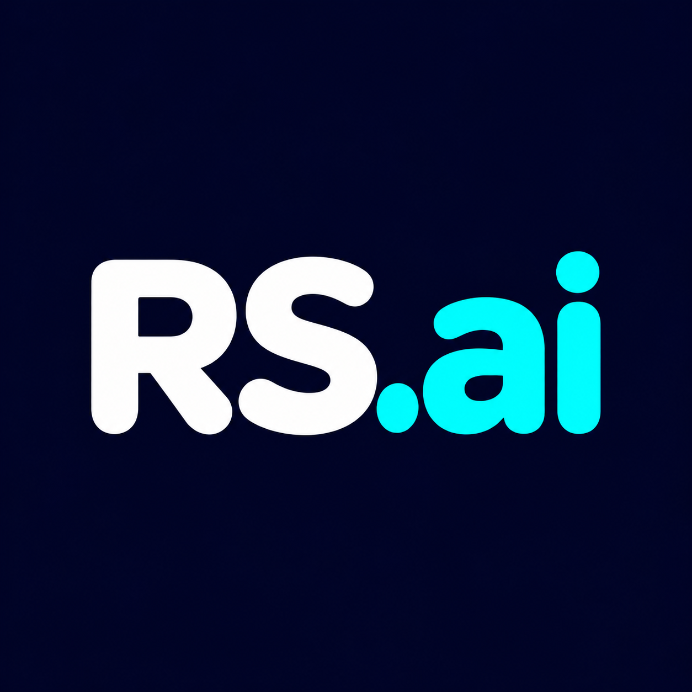

# RS.ai — Research Scout AI



**Discover More. Search Less.**

RS.ai is an AI-powered research discovery assistant that automatically collects, filters, and delivers relevant news, patents, and opportunities.

Built to make AI-assisted research more accessible to students, developers, founders, and educators using affordable hardware.

## Features

- **Automated Discovery** — Collects technology news, patents, hackathons, and other opportunities.
- **AI Classification** — Evaluates relevance, importance, and evidence quality.
- **Dual AI Providers** — Choose Gemini API or Local AI.
- **Custom Profiles** — Developer, Business, and Educator configurations.
- **Discord Integration** — Delivers findings to dedicated channels for easy sharing and collaboration.
- **Dashboard** — Monitor discoveries, approve processing, configure settings, and track results.
- **Duplicate Protection** — Helps prevent repeated notifications.

## Tech Stack

| Component | Technology |
|---|---|
| Backend | Python, FastAPI |
| AI | Gemini API, Ollama |
| Database | Supabase PostgreSQL |
| Dashboard | HTML, CSS, JavaScript |
| Notifications | Discord Webhooks |
| Configuration | JSON, environment variables |

## Setup

**Requirements:** Python 3.11+, Ollama for Local AI, and a Supabase project.

### 1. Clone the repository

```bash
git clone https://github.com/unjown/research-scout.git
cd research-scout
```

### 2. Create a virtual environment

```cmd
py -3.11 -m venv .venv
.venv\Scripts\activate
```

### 3. Install dependencies

```cmd
pip install -r requirements-local.txt
```

### 4. Configure environment variables

Copy `.env.example` to `.env` and configure the required Supabase credentials and Discord webhook settings.

```cmd
copy .env.example .env
```

For Local AI, install Ollama and download a supported model:

```cmd
ollama pull qwen3:4b
```

For Gemini, configure your API key through the RS.ai dashboard Settings panel.

### 5. Configure Supabase

Create the required tables and functions using the SQL files in the `database/` directory.

Review migrations before applying them. Historical reset scripts are not part of routine setup.

### 6. Start RS.ai

```cmd
python -m local.dashboard
```

Open:

http://127.0.0.1:8765

## Usage

1. Open the RS.ai dashboard.
2. Select your AI provider.
3. Choose research categories.
4. Approve a classification batch.
5. Monitor processing and review findings.
6. Receive relevant discoveries through Discord.

## AI Options

**Gemini API** — Cloud inference for convenient everyday research.

**Local AI** — On-device inference for greater control over data and reduced dependence on paid AI APIs.

Local AI performance depends on the model and available hardware.

## Future Roadmap

- Smaller, fine-tuned AI models.
- Improved low-memory inference.
- Support for repurposed Android devices.
- More personalized research filtering.
- Improved source verification.
- Affordable subscription options.

## Project Status

Hackathon prototype with working research discovery, classification, dashboard, and Discord integration.

Some advanced features remain under development.

---

**RS.ai — Discover More. Search Less.**